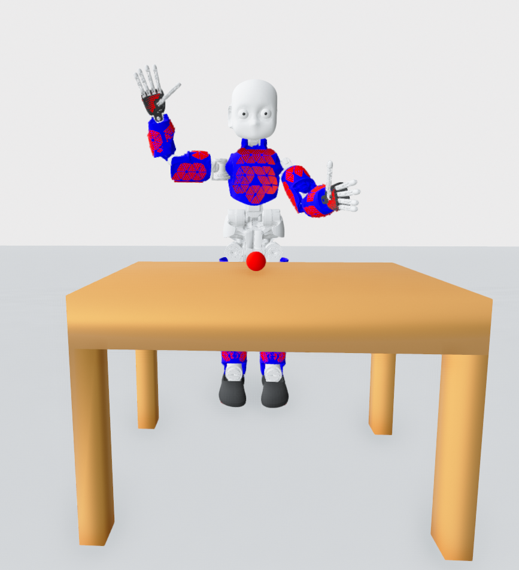

# pyCub

**pyCub** is a PyBullet-based simulator and educational robotics framework for the **iCub** humanoid robot. It provides both:

- **pyCub Studio** (`pycub-studio`) — a cross-platform desktop application with an embedded native OpenGL 3.3 / 2.1 viewport, five integrated learning/development modes, offline bilingual handbook, course exercises, live **English / Čeština** switching, and standalone OS installers.
- **`icub_pybullet`** — a lightweight Python package for joint, velocity, and Cartesian control, tactile skin simulation, stereo eye cameras, and example controllers (without Studio GUI dependencies or handbook assets).

[](https://rustlluk.github.io/pycub)

**Quick Links:**
[Project Website](https://rustlluk.github.io/pycub) |
[Local HTML Handbook](docs/handbook/index.html) |
[Online Handbook](https://rustlluk.github.io/pycub/handbook/index.html) |
[PDF Handbook (EN)](docs/handbook/pycub.pdf) |
[PDF příručka (CZ)](docs/handbook/cs/pycub.pdf)

---

## pyCub Studio (Standalone Desktop Application)

**pyCub Studio** packages the simulator into native installers and portable executables for **Windows (x64)**, **macOS (Apple Silicon `arm64` & Intel `x86_64`)**, and **Linux (`x86_64` & `arm64` `.AppImage` / `.deb`)**. All desktop modes render through a hardware-accelerated native OpenGL 3.3 / 2.1 viewport embedded directly inside the application window (no separate Open3D GUI window or browser needed).

### Five Integrated Modes

1. **Kid GUI (Native Buttons)** — Tactile playground with large preset actions, single-joint jog buttons, adjustable step size and speed, custom `.yaml` world loading, live ball distance/hit telemetry, and confetti celebration.
2. **Kid GUI "Scratch" (Visual Blocks)** — Offline Google Blockly visual programming with bilingual EN/CZ blocks, real-time active-block highlighting, `.pycub_blocks` save/load, live Python code preview, and one-click export to Kid Programming.
3. **Kid GUI "Programming" (High-Level Python)** — Beginner-friendly Python editor powered by [`icub_pybullet.kid_api`](icub_pybullet/kid_api.py) (`wave("right")`, `shoulder_up("left", 20)`, `look_down(15)`, `ball_touched()`, `ball_distance()`, etc., plus Czech aliases) with clickable Command Palette, hover/signature help, starter templates, and friendly error hints.
4. **Normal Mode (Full `pyCub` IDE & Script Runner)** — Multi-tab Python/YAML IDE with autocomplete, hover docs & Go to Definition (`F12`), external `.py` script runner (`--run-script` + auto-run on save), live stdout/stderr console, dockable `l_eye`/`r_eye` RGB & Depth camera views, coordinate axes toggle, RGB/Depth export, and one-click Course Exercises (`1–5`) installer + automated Exercise Tester.
5. **Classroom Web GUI Selector (Multi-Instance Server)** — Native dashboard to launch and supervise `N` independent browser-based `kid_ui` simulator instances behind a load-balanced landing page (`kid_ui_landing.py`), with LAN URLs, a scannable Wi-Fi QR code, live per-instance status/user counts, individual restart, and log inspection.

### Installing & Running `pyCub Studio` via `pip`

Requires **Python 3.10–3.12**. You can install `pycub-studio` as a Python package so it launches from any working directory (no cloned repository needed):

```bash
python3 -m venv .venv
source .venv/bin/activate
python3 -m pip install --upgrade pip

# From PyPI (installs icub_pybullet + Studio GUI + handbook + exercises + examples):
python3 -m pip install pycub-studio
# Equivalently: python3 -m pip install "icub_pybullet[studio]"

# Or from a local repository clone:
python3 -m pip install ./icub_pybullet ./studio
# (For editable development installs: python3 -m pip install -e ./icub_pybullet -e ./studio)

# Launch Home Mode Selector
pycub-studio
# (or: python3 -m studio.main)

# Launch directly into a specific mode (home | kid_native | kid_scratch | kid_code | normal | web)
pycub-studio --mode kid_scratch --lang cs

# Open Normal Mode and immediately run an external Python script
pycub-studio --run-script /path/to/your_script.py
```

On Windows PowerShell, activate the virtual environment with `.venv\Scripts\Activate.ps1`.

### User Workspace & Extra Python Packages (`~/Documents/pyCub/`)

On first launch, `pyCub Studio` creates a writable workspace in `~/Documents/pyCub/`:

- `worlds/` — Custom `.yaml` world configs (automatically listed in the world selector across Modes 1–3 & 5). Custom worlds can inherit built-in configs via `parent: default.yaml` or `parent: with_ball.yaml`.
- `meshes/` — Custom `.obj` or `.urdf` scene models. Any `.obj` without a pre-baked `*_vhacd.obj` automatically runs `pybullet.vhacd` on first load and caches the convex decomposition in `<user_cache_dir>/pycub/vhacd/`.
- `extra_packages/` — Automatically added to `sys.path` in simulation and script workers for third-party libraries not bundled in the installer.
- `scripts/`, `projects/`, `exercises/`, `examples/`, `images/` — Saved Python scripts, Scratch `.pycub_blocks` projects, unpacked course exercises, and exported RGB/Depth screenshots.

**External scripts & packages without system Python:** Scripts in Mode 4 or `--run-script` run in an isolated worker using Studio's bundled Python runtime (`pybullet`, `numpy`, `scipy`, `open3d`, `roboticstoolbox`, `spatialmath`, `matplotlib`, etc.). Click **Packages / Python** in the top bar to install PyPI packages into `extra_packages/`, attach `site-packages` from an existing virtual environment, or select an external Python executable for Mode 4 scripts.

---

## Building `pyCub Studio` (Native Installers & Bundles)

### Option 1: Cross-Platform CI Build (Recommended)

Trigger [`.github/workflows/release-standalone.yml`](.github/workflows/release-standalone.yml) manually (`workflow_dispatch`, with optional version input) or push a `v*` tag to build all five targets in parallel and attach them to a GitHub Release:

- **Linux `x86_64` & `arm64`**: `.AppImage` and `.deb` (`pycub-studio`)
- **Windows `x64`**: `pyCub-Setup-<version>-Windows-x64.exe`
- **macOS `arm64` (Apple Silicon) & `x86_64` (Intel)**: `.dmg`

### Option 2: Local Builds

Common prerequisites:
- **Python 3.10–3.12** (Python 3.13+ is not yet supported by all robotics dependencies).
- *(Optional)* If you edited documentation in `docs/source/`, `docs/source_cs/`, or `exercises/`, rebuild the offline handbook first (`python docs/build.py`) so `packaging/pycub.spec` bundles the updated `docs/handbook/`.

#### Linux (`x86_64` and `arm64`)

1. Install required system libraries (Debian/Ubuntu):
   ```bash
   sudo apt-get update
   sudo apt-get install -y --no-install-recommends \
     libegl1 libgl1 libxcb-cursor0 libnss3 libasound2 libfuse2 dpkg-dev curl
   # On Linux arm64, also install build tools because pybullet compiles from source:
   # sudo apt-get install -y build-essential python3-dev
   ```
2. Run the packaging script from the repository root (automatically creates an isolated `packaging/work/build_venv` unless `PYTHON_BIN` is provided):
   ```bash
   bash packaging/linux/build_linux.sh
   ```
   Optional environment variables:
   - `PYCUB_VERSION=1.4.0` — override artifact version string.
   - `REBUILD_VENV=1` — recreate `packaging/work/build_venv` from scratch.
   - `PYTHON_BIN=/path/to/python` — use a pre-configured interpreter that already has `icub_pybullet`, `studio/requirements.txt`, and `pyinstaller>=6.10`.
3. Outputs in `packaging/out/`:
   - `pycub-studio_<version>_<amd64|arm64>.deb`
   - `pyCub-<version>-Linux-<x86_64|arm64>.AppImage`

#### Windows (`x64`)

1. Activate a Python 3.10–3.12 environment with Studio and PyInstaller dependencies installed:
   ```powershell
   python -m pip install --upgrade pip setuptools wheel
   python -m pip install .\icub_pybullet
   python -m pip install -r .\studio\requirements.txt
   python -m pip install "pyinstaller>=6.10"
   ```
2. Install [Inno Setup 6](https://jrsoftware.org/isinfo.php) (e.g. `choco install innosetup -y`) to generate the `Setup.exe` installer.
3. Run the Windows build script:
   ```powershell
   $env:PYCUB_VERSION = "1.4.0"   # optional
   powershell -ExecutionPolicy Bypass -File packaging\windows\build_windows.ps1
   ```
4. Output in `packaging/out/`:
   - `pyCub-Setup-<version>-Windows-x64.exe`

#### macOS (`arm64` Apple Silicon & `x86_64` Intel)

1. Install dependencies in a Python 3.10–3.12 environment:
   ```bash
   python3 -m pip install --upgrade pip setuptools wheel
   # On Intel macOS (x86_64), pin Open3D 0.19.0 (last wheel supporting Intel macOS):
   # python3 -m pip install "open3d==0.19.0"
   python3 -m pip install ./icub_pybullet
   python3 -m pip install -r studio/requirements.txt
   python3 -m pip install "pyinstaller>=6.10"
   ```
2. Build `.app` bundle (ad-hoc signed) and `.dmg`:
   ```bash
   PYCUB_VERSION=1.4.0 bash packaging/macos/build_dmg.sh
   ```
3. Output in `packaging/out/`:
   - `pyCub-<version>-macOS-<arm64|x86_64>.dmg`

#### Raw PyInstaller Bundle (Any OS)

To build only the unpacked PyInstaller application directory (`dist/pyCub` or `dist/pyCub.app`) without creating OS installers:

```bash
pyinstaller --noconfirm packaging/pycub.spec
```

---

## Python Package Installation (`icub_pybullet` & `pycub-studio`)

- **`icub_pybullet`** installs the simulator, robot meshes/URDFs, YAML configs, `kid_api`, and example scripts cleanly on their own — without Qt/PySide6, Studio UI, or the offline handbook.
- **`pycub-studio`** (or `icub_pybullet[studio]`) depends on `icub_pybullet` and adds the full desktop application, Blockly assets, offline HTML/PDF handbook, and course exercises (1–5) with the `pycub-studio` launcher command.

- Requires **Python 3.10 to 3.12** (newer Python versions are not currently supported due to dependency compatibility).
- Recommended: create a virtual environment first:
  ```bash
  python3 -m venv pycub_venv
  source pycub_venv/bin/activate
  ```

1. **Install from PyPI (recommended):**
   ```bash
   python3 -m pip install icub_pybullet          # simulator library only
   python3 -m pip install pycub-studio           # or "icub_pybullet[studio]" for full Studio
   ```
2. **Install from source:**
   ```bash
   git clone https://github.com/rustlluk/pyCub.git
   cd pyCub
   python3 -m pip install --upgrade pip
   python3 -m pip install ./icub_pybullet        # simulator library only
   python3 -m pip install ./icub_pybullet ./studio   # simulator + pycub-studio command
   ```
3. **Docker / Gitpod:**
   - Native Docker (GNU/Linux): see [Native Version](#native-version)
   - VNC Docker (Windows/macOS/Linux): see [VNC Version](#vnc-version)
   - Gitpod: open [https://app.gitpod.io/#https://github.com/rustlluk/pycub](https://app.gitpod.io/#https://github.com/rustlluk/pycub), log in with GitHub, open port `6080`, and run `start-vnc-session.sh` in the terminal.

### Examples & Core Modules

- [push_the_ball_pure_joints.py](https://github.com/rustlluk/pycub/blob/master/icub_pybullet/examples/push_the_ball_pure_joints.py) — controlling the robot in joint space.
- [push_the_ball_cartesian.py](https://github.com/rustlluk/pycub/blob/master/icub_pybullet/examples/push_the_ball_cartesian.py) — controlling the robot in Cartesian space (`Pose` + IK).
- [skin_test.py](https://github.com/rustlluk/pycub/blob/master/icub_pybullet/examples/skin_test.py) — tactile skin contacts with balls falling onto the robot (slow down simulation or check `skin_activations`).
- Simulator core: [pycub.py](https://github.com/rustlluk/pycub/blob/master/icub_pybullet/pycub.py)
- Beginner API: [kid_api.py](icub_pybullet/kid_api.py)
- Visualization backend: [visualizer.py](https://github.com/rustlluk/pycub/blob/master/icub_pybullet/visualizer.py) (uses Open3D for standalone scripts, web fallback, or the embedded OpenGL viewport inside `pyCub Studio`).

---

## Documentation & Building the Handbook

Open **Handbook** in `pyCub Studio` or browse the [local HTML handbook](docs/handbook/index.html) (online at [pyCub Handbook](https://rustlluk.github.io/pycub/handbook/index.html); PDF: [English](docs/handbook/pycub.pdf), [Čeština](docs/handbook/cs/pycub.pdf)). The handbook covers Studio modes, Python programming across Kid/Studio/Normal modes, examples, course exercises, and the auto-generated API reference.

To rebuild the English and Czech HTML + PDF handbooks from the repository root (Python 3.10–3.12):

```bash
python3 -m pip install -r docs/requirements.txt
python3 docs/build.py          # builds HTML + PDF (pass --no-pdf to skip LaTeX PDF)
```

The build writes `docs/handbook/index.html`, `docs/handbook/cs/index.html`, and (when `latexmk` + `pdflatex` + `make` are installed) `docs/handbook/pycub.pdf` and `docs/handbook/cs/pycub.pdf`. Commit the rebuilt `docs/handbook/` alongside documentation changes so GitHub Pages and offline Studio installers pick them up. To preview the full Jekyll site locally, run `jekyll serve` inside `docs/`.

For additional Sphinx targets, run `make -C docs help` or `docs\make.bat help`.

---

## FAQ & Known Issues

1. **Visualization errors or segmentation faults (e.g. with Open3D):**
   1. Run `pyCub Studio` (`pycub-studio` or `python3 -m studio.main`), which uses an embedded native OpenGL 3.3 / 2.1 viewport instead of a separate Open3D GUI window.
   2. Check your graphics drivers (Mesa / OpenGL / NVIDIA).
   3. Use [Native Docker](#native-version) (Linux) or [VNC Docker](#vnc-version).
   4. In your `.yaml` config, set `gui.standard: False` and `gui.web: True` to use the browser visualizer.
2. **Import errors (e.g. `No module named icub_pybullet`):**
   1. Install from PyPI (`python3 -m pip install icub_pybullet` or `pycub-studio`) or from source (`python3 -m pip install ./icub_pybullet`).
   2. Or add the repository root directory to your `PYTHONPATH`.
3. **Known bug with Open3D skin visualization:**
   - In standalone Open3D mode, visualization with tactile skin active can crash after ~65k steps (see [Open3D#4992](https://github.com/isl-org/Open3D/issues/4992)). `pyCub Studio`'s embedded OpenGL viewport is not affected.

---

## Docker

### Native Version

- Native GUI inside Docker (GNU/Linux only — Ubuntu, Mint, Arch, etc.); useful for avoiding host OpenGL driver issues.
1. Install [docker-engine](https://docs.docker.com/engine/install/ubuntu/) (**do not install Docker Desktop** on Linux) and perform the [Linux post-installation steps](https://docs.docker.com/engine/install/linux-postinstall/).
2. Clone the repository and pull or build the image:
   ```bash
   git clone https://github.com/rustlluk/pyCub.git
   cd pyCub/Docker
   # Pull prebuilt image from Docker Hub:
   ./deploy.py -p /path/to/pyCub -c pycub -pu
   # Or build locally:
   ./deploy.py -p /path/to/pyCub -c pycub -b
   ```
3. Run an existing container or open a new terminal in it:
   ```bash
   ./deploy.py -c pycub -e   # start/attach
   ./deploy.py -c pycub -t   # open another terminal
   ```

### VNC Version

- Works on Windows, macOS, and Linux; displays the GUI in your browser at [http://localhost:6080](http://localhost:6080).
1. Install [docker-engine](https://docs.docker.com/engine/install/ubuntu/) (Linux) or [docker-desktop](https://docs.docker.com/desktop/) (all systems) and complete any post-install steps.
2. Pull or build with `-vnc`:
   ```bash
   cd /path/to/pyCub/Docker
   ./deploy.py -p /path/to/pyCub -c pycub -pu -vnc
   ```
3. Inside the container, run `start-vnc-session.sh` and open [http://localhost:6080](http://localhost:6080).

### Docker + PyCharm

- **Native Version:** Either launch PyCharm inside Docker, or configure an SSH interpreter in host PyCharm (`user: docker`, host `localhost` or server IP, port `2222`, disable automatic upload, map remote path to `/home/docker/pycub_ws`).
- **VNC / Gitpod Version:** Open PyCharm directly inside the container.

### Deploy Parameters

Run `./deploy.py` inside `Docker/`:
- `-b` / `--build`: Build the Docker image (default: `False`).
- `-e`: Run an existing container without rebuilding (default: `False`).
- `-p` / `--path`: Path to the repository folder (default: `""`).
- `-pu` / `--pull`: Pull image from Docker Hub (default: `False`).
- `-c` / `--container`: Container name (default: `my_new_docker`).
- `-t` / `--terminal`: Open a new terminal in a running container (default: `False`).
- `-pv` / `--python-version`: Python version to install (default: `3.11`).
- `-pcv` / `--pycharm-version`: PyCharm version to install (default: `2023.2.3`).
- `-bi` / `--base-image`: Base Docker image (default: `ubuntu:20.04`).

Run `deploy.py` on the machine where you run the code (over SSH if using a remote server).

### Docker FAQ

- **Not in `sudo` group when running the pulled image:** Check `id -u`. If your UID is not `1000`, build the image locally instead of pulling it.
- **`sudo apt install ...` fails inside the container:** Run `sudo apt update` first (apt caches are cleaned in the `Dockerfile` to save space).

---

## Citing

When used in academic work, please cite this repository as:

```bibtex
@inproceedings{rustler2026pycub,
      title={Learning with pyCub: A Simulation and Exercise Framework for Humanoid Robotics},
      author={Lukas Rustler and Matej Hoffmann},
      year={2026},
      booktitle={17th International Conference on Robotics in Education (RiE 2026)},
      organization={Springer}}
```

## License

[![CC BY 4.0][cc-by-shield]][cc-by]

This work is licensed under a [Creative Commons Attribution 4.0 International License][cc-by].

[![CC BY 4.0][cc-by-image]][cc-by]

[cc-by]: http://creativecommons.org/licenses/by/4.0/
[cc-by-image]: https://i.creativecommons.org/l/by/4.0/88x31.png
[cc-by-shield]: https://img.shields.io/badge/License-CC%20BY%204.0-lightgrey.svg
