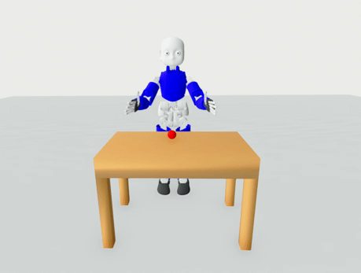

# Odtlačení míčku (Push the Ball)

Cílem úlohy je udeřit do míčku a odtlačit jej co nejdále od **jakékoli části** stolu.
Míček se vždy objeví na stejném místě. Robota lze ovládat pomocí pozičního nebo
kartézského řízení. Trajektorie musí být bezkolizní (vůči stolu) a maximální
povolená rychlost je 10 rad/s.

Výsledná vzdálenost se vyhodnocuje po 2 sekundách.

## Úkol
Implementujte funkci `push_the_ball` v souboru [exercise_1.py](https://github.com/rustlluk/pycub/blob/master/exercises/exercise_1/exercise_1.py), která odtlačí míček co nejdále od stolu.
- Funkce přijímá jeden argument:
  - `client` – instance třídy `pyCub` ovládající simulaci
  - nevytvářejte ve svém kódu novou instanci klienta!

## Bodování
- Body za vzdálenost se počítají jako: `min(3, distance * 2)`
  - tj. maximálně 3 body získáte při odtlačení míčku alespoň 1,5 m od stolu.

## Požadavky
**Požadavky nutné pro správnou funkci testeru** [exercise_1_tester.py](https://github.com/rustlluk/pycub/blob/master/exercises/exercise_1/exercise_1_tester.py):
- nevytvářejte nového klienta, použijte předaný argument `client`
- nepřejmenovávejte funkci ani soubor
- **nevkládejte** umělé prodlevy, např. `sleep()` nebo volání `update_simulation()` po dokončení pohybu

**Požadavky na správné splnění úlohy:**
- Trajektorie nesmí kolidovat se stolem (vlastní kolize robota jsou povoleny)
- Maximální povolená rychlost je 10 rad/s
- **Nevypínejte** gravitaci
