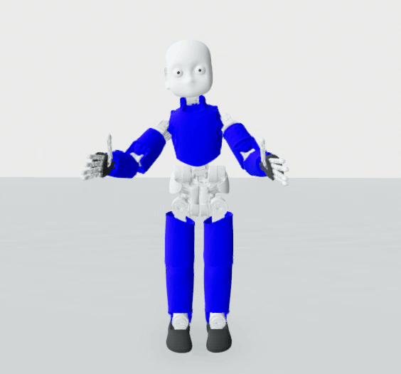

# Plynulé pohyby (Smooth movements)

Úkolem je provádět plynulé pohyby rukou robota. Robot má být schopen pohybovat se po
přímce nebo po kružnici s plynulou trajektorií — pohyb tedy musí být spojitý a bez trhání.

## Úkol
Implementujte funkci `move()` v souboru [exercise_2.py](https://github.com/rustlluk/pycub/blob/master/exercises/exercise_2/exercise_2.py), která bude pohybovat rukou robota po přímce nebo kružnici.

- Funkce přijímá čtyři argumenty:
  - `client` – instance třídy `pyCub` ovládající simulaci
  - `action` – řetězec `"line"` (přímka) nebo `"circle"` (kružnice)
  - `axis` – seznam celých čísel. Pro `"circle"` má vždy délku 1. Pro `"line"` může mít délku 1–3. Čísla udávají osy, podél kterých se má robot pohybovat (např. `[0, 1]` znamená pohyb v osách x a y).
  - `r` – seznam desetinných čísel (stejné délky jako `axis`), v metrech. Pro `"circle"` jde o poloměr kružnice, pro `"line"` o délku úsečky v dané ose.
- Ukázkové vstupy:
  - `action="circle", axis=[0], r=[0.01]` – koncový efektor opíše kružnici kolem osy x s poloměrem 0,01 m
  - `action="line", axis=[1], r=[-0.05]` – koncový efektor se posune po přímce v ose y o −0,05 m
  - `action="line", axis=[0, 1], r=[0.05, -0.05]` – koncový efektor se posune současně v ose x o 0,05 m a v ose y o −0,05 m (výsledkem je jedna šikmá přímka)
- Funkce **musí** vrátit dvě hodnoty: počáteční a koncovou pózu trajektorie
  - obě získejte pomocí `client.end_effector.get_position()`

## Bodování
- Získáte 10 náhodných testovacích případů (po 1 bodu).
- Kruhové i přímkové pohyby se vyhodnocují podle tří dílčích kritérií:
  - **kružnice**:
    - směrodatná odchylka vzdálenosti bodů kružnice od středu musí být `< r * 0.125`
    - rozdíl očekávaného a skutečného poloměru musí být `< r * 0.1`
    - průměrná vzdálenost bodů od očekávané roviny musí být `< 0.1`
  - **přímka**:
    - rozdíl skutečné a očekávané délky musí být `< 0.0075`
    - úhel mezi očekávanou a skutečnou přímkou musí být `< 0.1`
    - průměrná vzdálenost všech bodů od očekávané přímky musí být `< 0.01`
- **Plynulost pohybu není automatickým testerem kontrolována!**
- **Kód by měl být co nejobecnější**, aby fungoval pro jakýkoli povolený vstup (nepište např. dlouhé `if/else` větvení pro každou kombinaci os).

## Požadavky
**Pro správnou funkci testeru** [exercise_2_tester.py](https://github.com/rustlluk/pycub/blob/master/exercises/exercise_2/exercise_2_tester.py):
- nevytvářejte nového klienta, použijte předaný argument `client`
- nepřejmenovávejte funkci ani soubor
- **vraťte dvě hodnoty:** počáteční a koncovou pózu trajektorie typu `utils.Pose`

**Pro správné splnění úlohy:**
- **Nevypínejte** gravitaci
- Udělejte pohyb co nejplynulejší
