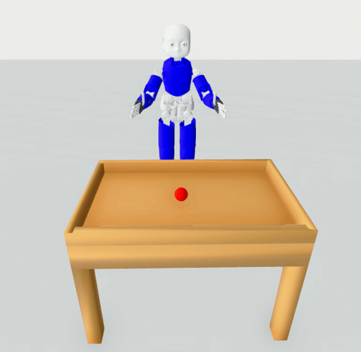

# Řízení pohledu (Gaze control)

Cílem této úlohy je implementovat řízení pohledu (gaze controller) pro robota iCub,
které dokáže sledovat míček pohybující se po stole. Úloha je zjednodušena na 2D případ
(míček se pohybuje v osách *x* a *y*). K dispozici máte vektor z hlavy k míčku (kam se
má robot dívat) a vektor směru, kam se robot dívá právě teď.

## Úkol
Implementujte funkci `gaze()` v souboru [exercise_3.py](https://github.com/rustlluk/pycub/blob/master/exercises/exercise_3/exercise_3.py), která bude řídit pohled robota při sledování míčku.

- Funkce přijímá tři argumenty:
  - `client` – instance třídy `pyCub` ovládající simulaci
  - `head_direction` – normalizovaný vektor představující aktuální směr pohledu robota
  - `head_ball_direction` – normalizovaný vektor z hlavy robota směrem k míčku (cílový směr pohledu)
- Funkce má ovládat krční klouby robota tak, aby sledoval míček:
  - pohyb **musí** být neblokující, tj. s parametrem `wait=False`
  - v této funkci **nevolejte** `update_simulation()`

## Bodování
- Míček se pohybuje po dobu 10 s (výchozí nastavení) a v každém kroku se měří chyba ve stupních.
- Maximální počet bodů je 10 (10 běhů); body můžete **ztratit** za jednotlivé běhy podle:
  - průměrná absolutní chyba:
    - `< 0.5°` – ztráta 0 % bodů
    - `0.5° – 1°` – ztráta 50 % bodů
    - `1° – 5°` – ztráta 75 % bodů
    - `> 5°` – ztráta 100 % bodů
  - maximální chyba:
    - `< 2°` – ztráta 0 % bodů
    - `2° – 5°` – ztráta 25 % bodů
    - `5° – 10°` – ztráta 50 % bodů
    - `> 10°` – ztráta 100 % bodů
- Ztráty z průměrné a maximální chyby se sčítají (např. 75 % za průměr a 25 % za maximum znamená 100 % ztrátu a 0 bodů).

## Požadavky
**Pro správnou funkci testeru** [exercise_3_tester.py](https://github.com/rustlluk/pycub/blob/master/exercises/exercise_3/exercise_3_tester.py):
- nevytvářejte nového klienta, použijte předaný argument `client`
- nepřejmenovávejte funkci ani soubor
- **používejte neblokující pohyby**, tj. parametr `wait=False` nebo rychlostní řízení
- v žádném místě kódu **nevolejte** `update_simulation()`

**Pro správné splnění úlohy:**
- **Nevypínejte** gravitaci
