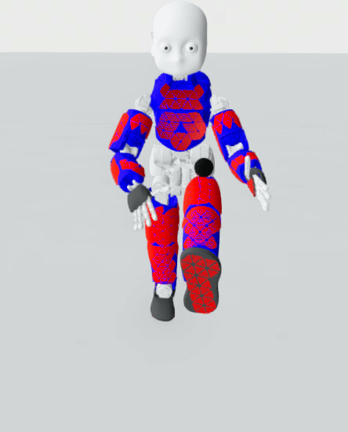
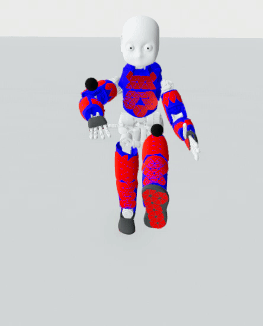
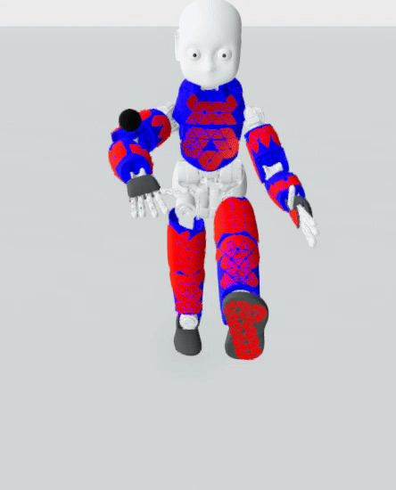
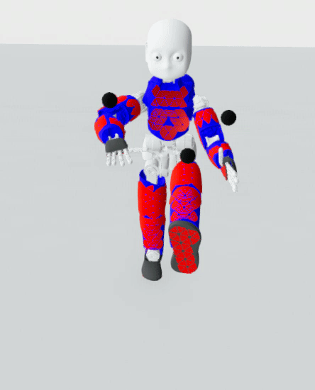

# Řízení pomocí jakobiánu (Resolved-Rate Motion Control)

Cílem úlohy je implementovat regulátor RRMC (Resolved-Rate Motion Control), který
uhýbá končetinami před kolizemi na základě zpětné vazby z umělé kůže robota. Na robota
budou padat míčky a příslušnou část těla je třeba odsunout od kontaktu — tj. pohybovat
jí proti normále dotyku.

| Jedna končetina | Více končetin |
| --- | --- |
|  |  |
|  |  |

## Úkol
Implementujte metodu `process()` v souboru [exercise_4.py](https://github.com/rustlluk/pycub/blob/master/exercises/exercise_4/exercise_4.py), která bude ovládat robota pomocí RRMC. Funkce je tentokrát metodou třídy, abyste si mohli uchovávat vlastní stavové proměnné.

- Třída přijímá jeden argument:
  - `client` – instance třídy `pyCub` ovládající simulaci
- Funkce má klouby ovládat pomocí RRMC, tedy rychlostním řízením (`move_velocity`)
- V kódu **nesmíte** volat `update_simulation()`

Postupně dostanete čtyři scénáře s různými částmi těla zasaženými různým počtem míčků.
Uhýbejte každou částí kůže, která je v kolizi s libovolným míčkem, ale pro každou část
kůže použijte vždy jeden kontakt — najděte největší shluk (klastr) aktivovaných taxelů
na dané části kůže.

Testovací skript [exercise_4_tester.py](https://github.com/rustlluk/pycub/blob/master/exercises/exercise_4/exercise_4_tester.py)
spustí všechny čtyři testy postupně od nejjednoduššího. Po každém testu zavřete okno
vizualizace (případně ukončete běh ve Studiu).

## Bodování
Pro tuto úlohu není automatické číselné hodnocení. Úloha je splněna tehdy, když robot
spolehlivě uhýbá před padajícími míčky. Ukázkové výsledky vidíte v animacích výše;
nejde však o jediné správné řešení, chování závisí na zvolených parametrech RRMC.

## Požadavky
**Pro správnou funkci testeru** [exercise_4_tester.py](https://github.com/rustlluk/pycub/blob/master/exercises/exercise_4/exercise_4_tester.py):
- nevytvářejte nového klienta, použijte argument `client` předaný třídě RRMC
- nepřejmenovávejte funkci, soubor ani třídu
- v kódu **nevolejte** `update_simulation()`

**Pro správné splnění úlohy:**
- **Nevypínejte** gravitaci
