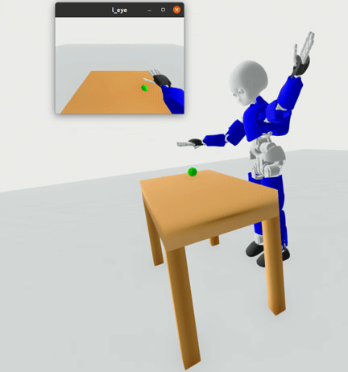

# Uchopení míčku (Grasp It!)

Cílem úlohy je uchopit míček ze stolu. Úloha je rozdělena na dvě části:
- najít míček na stole v obrazové rovině kamery (míček je v zorném poli robota a je zelený)
- uchopit míček: pomocí polohy míčku v obrazu a hloubkové mapy spočítat jeho 3D polohu a uchopit jej rukou

## Úkol
Implementujte metody `find_the_ball()` a `grasp()` v souboru [exercise_5.py](https://github.com/rustlluk/pycub/blob/master/exercises/exercise_5/exercise_5.py). Obě jsou metodami třídy `Grasper`, která již obsahuje několik užitečných pomocných metod. Po uchopení zvedněte míček tak, aby byl alespoň 5 cm nad stolem.

Třída přijímá dva argumenty:
- `client` – instance třídy `pyCub` ovládající simulaci
- `eye` – název oka s kamerou (`'l_eye'` nebo `'r_eye'`)

Předepsané rozhraní obou metod:
- `find_the_ball()` – bez argumentů, vrací `(u, v)` (střed míčku v obrazové rovině)
- `grasp(center)` – přijímá jeden argument `center` (2D střed z `find_the_ball()`) a při úspěšném uchopení vrací `0`

Do třídy můžete libovolně přidávat vlastní metody a atributy, tester však volá pouze `find_the_ball()` a `grasp()`. Třída `Grasper` obsahuje pomocné metody pro získání RGB a hloubkového obrazu, zpětnou projekci 2D bodu do 3D i zavření prstů.

Míček je vždy zelený `(0, 255, 0)` a má poloměr 2,5 cm.

## Bodování
- Pokud je míček po návratu z `grasp()` alespoň 5 cm nad stolem a v ruce robota, testem projdete.

## Požadavky
**Pro správnou funkci testeru** [exercise_5_tester.py](https://github.com/rustlluk/pycub/blob/master/exercises/exercise_5/exercise_5_tester.py):
- nevytvářejte nového klienta, použijte předaný argument `client`
- nepřejmenovávejte `find_the_ball()`, `grasp()` ani soubor
- po návratu z `grasp()` musí být míček alespoň 5 cm nad stolem a držen v ruce robota

**Pro správné splnění úlohy:**
- **Nevypínejte** gravitaci
